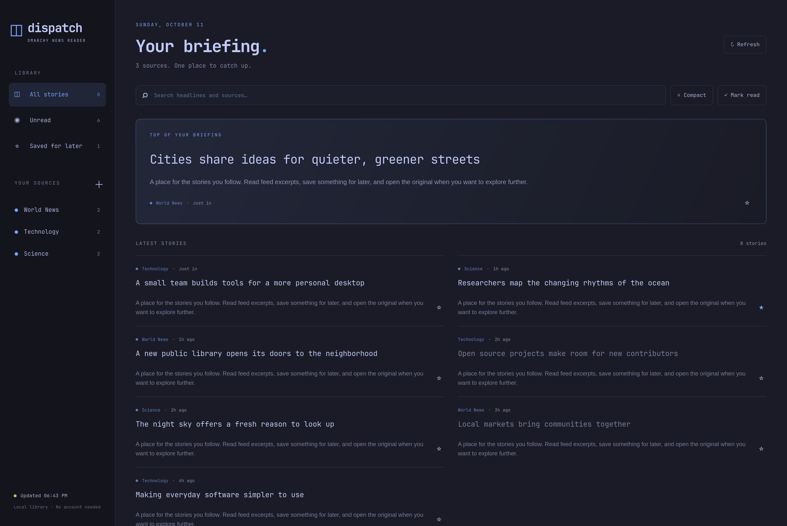

# Dispatch



A local news reader for Omarchy, styled with your active theme. Read RSS and Atom feeds in one calm interface, with a Drudge Report RSS source included.

- All, unread and saved-story views; search across sources and excerpts.
- Add and remove RSS/Atom subscriptions, verified before saving.
- Article previews, four reading layouts and five-minute refresh.
- Saved reading preferences: Briefing, Wide blocks, Feed and Headlines only; optional publisher photos.
- Cached headlines when a publisher is unavailable; saved stories remain in your library.
- Theme colors update automatically. No account, hosted service or tracking scripts. Publisher photos are optional and off by default.
- Omarchy shell command, launcher entry and optional bar button.

Starter sources: BBC World, The Guardian World, NPR News, Ars Technica and Drudge Report. Use **+ beside Your Sources** to add more feeds. Feed content varies in length. Dispatch shows full feed text when supplied and loads a styled reader view from publisher pages for short entries. Paywalls, blocked requests and unsupported pages may require the original site.

## Install

Requires Omarchy Quattro with its plugin-capable Quickshell, Python 3.11+, GTK 3, PyGObject and WebKitGTK 4.1. Install the Arch dependencies yourself:

```sh
omarchy pkg add python python-gobject gtk3 webkit2gtk-4.1
omarchy plugin add https://github.com/samcapshaw/dispatch.git --enable
```

The plugin opens the reader on demand. It registers a **Dispatch** desktop launcher and provides an optional news button in the bar. Open directly with:

```sh
omarchy-shell dispatch open
```

The launcher's icon and entry are installed in your user account. The plugin leaves any existing entry at its own path alone unless it carries Dispatch's managed marker. It does not change keybindings, dock pins, existing desktop entries or system configuration. Pin the launcher using your dock's normal controls if desired.

For standalone use from a checkout, run `python reader.py` with the same Python/GTK dependencies.

## Use

Click a headline to read inside Dispatch; short feed entries automatically load a reader view from the publisher. **Load reader view** also fetches publisher text on demand. **Read original** opens the publisher in your browser. Use the star to save a story. `/` or Ctrl+F searches, Ctrl+R refreshes, and Escape closes a dialog. Source management is available from **+**. Open **Layout & photos** for layout and photo preferences, which save automatically. Existing compact-layout users keep the Headlines only view.

## Storage and network access

Subscriptions and reading state: `~/.local/share/omarchy-news/`. Cached feeds: `~/.cache/omarchy-news/`. These locations match the original standalone Dispatch app, preserving existing libraries.

Dispatch contacts your configured feeds at launch, every five minutes while open, and when you refresh. Adding a source fetches its URL to verify RSS/Atom content. Drudge uses the FeedPress Drudge Report feed, falling back to its public homepage if the feed is unavailable. FeedPress tracking-pixel images are excluded. A source failure keeps the last cached stories. Response size is limited to 5 MB and requests time out after 20 seconds.

Source markup is converted to text. Feed scripts and HTML are not rendered. When you enable story photos, the reading surface also loads feed-provided images from publishers and their image hosts without a referrer. Missing or failed photos fall back to text; Headlines only stays text-only. Refresh existing feeds to discover their images. Opening a short entry or choosing Load reader view fetches that publisher page (up to 5 MB, 20-second timeout). Reader view extracts text without executing publisher scripts or rendering their HTML; results are kept in memory until Dispatch closes. It does not bypass subscriptions. Opening an original article delegates to your browser. Feed availability and publisher formats may change. This app is independent of the publications.

## Remove

```sh
omarchy plugin remove io.github.samcapshaw.dispatch
```

Disabling/removing the plugin removes only its managed launcher and matching icon. Close any running Dispatch window separately. Your subscriptions, read history, saved stories and feed cache are retained. To erase them deliberately, delete the two storage directories listed above. A separately installed standalone version is unaffected.

## Development

```sh
python -m unittest discover -v
node --check app.js
omarchy plugin validate .
```

The Python backend uses the standard library for fetching and parsing; GTK/WebKit provide the desktop window. The QML service and bar widget are thin Omarchy integrations. No package installation or network downloads happen when enabling the plugin.

MIT licensed. The application code and SVG icon are original work. Publisher names, headlines and excerpts belong to their respective owners and are fetched at runtime; none are bundled with this repository.
